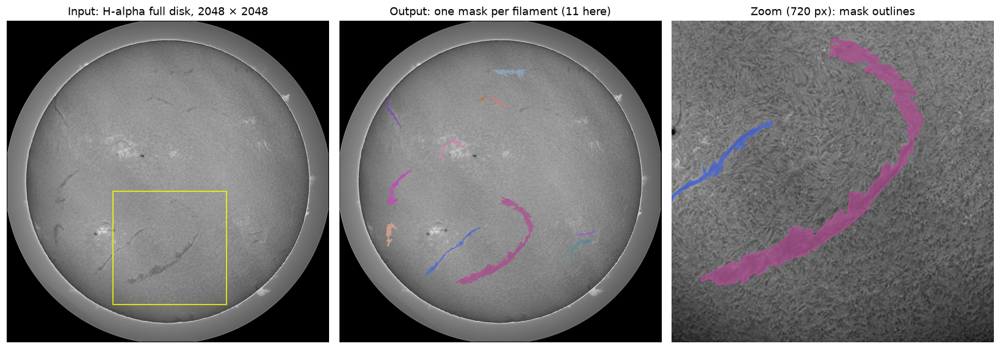
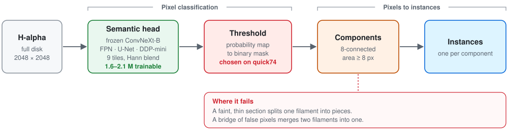
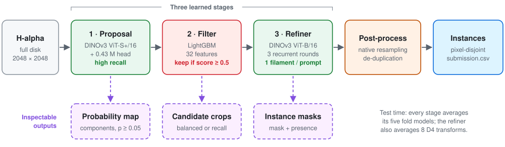
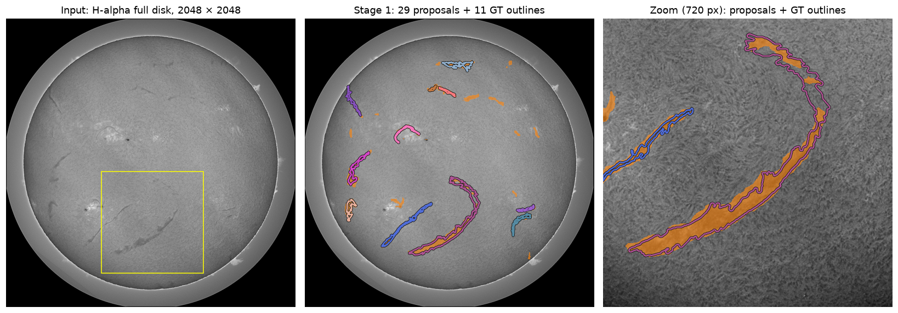
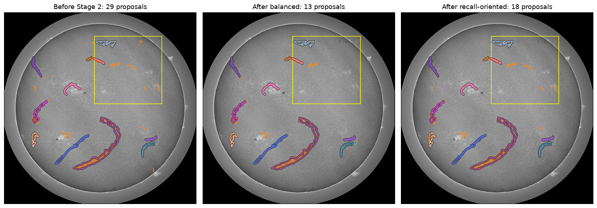
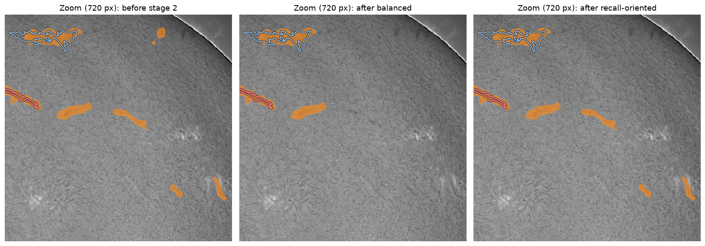
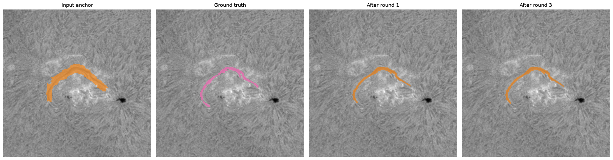
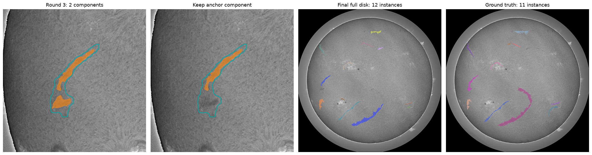
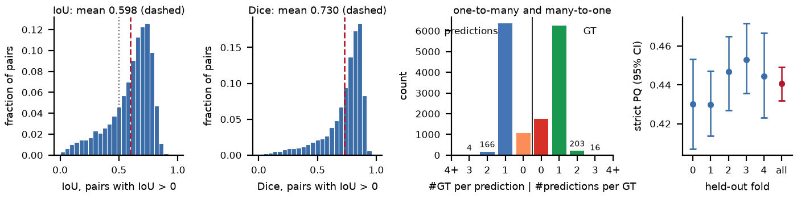
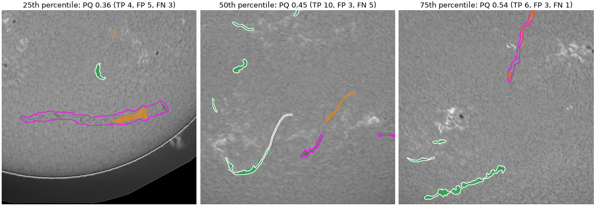

# Prompted Recurrent Refinement for Solar Filament Instance Segmentation

Solution of **Phạm Đức Công** and **Lê Anh Đức** (FPT University, Hanoi, Vietnam) to the
[Solar Filament Segmentation Challenge 2026](https://www.kaggle.com/competitions/filament-segmentation-2026)
(IEEE BigData Cup 2026; MAGFiLO annotations on GONG H-alpha full-disk images; metric: Panoptic Quality).
The repository contains the inference package, the trained weights, an end-to-end notebook, the training code of
every learned stage and the technical report ([`report/main.pdf`](report/main.pdf)).

| | Panoptic Quality |
|---|---|
| **Final pipeline**, out-of-fold on the 707 labelled images (§4) | **0.4405** |
| Final pipeline, public leaderboard (about half of the 180 test images) | 0.39 |
| Baseline: standard DDP semantic head trained on the same folds, out-of-fold (§2.6) | 0.389 |
| Same baseline, public leaderboard | 0.34 |
| Reference: one expert annotator scored against another (296 multi-annotated images) | 0.34 |

## Contents

1. [The task](#1-the-task)
2. [Baseline: semantic segmentation + connected components](#2-baseline-semantic-segmentation--connected-components)
3. [Final pipeline: proposal → filter → refiner](#3-final-pipeline-proposal--filter--refiner)
4. [Results](#4-results)
5. [Quick start](#5-quick-start)
6. [Reproducibility](#6-reproducibility)
7. [Training](#7-training)
8. [Repository layout](#8-repository-layout)
9. [Known limitations](#9-known-limitations)
10. [License, data and acknowledgements](#10-license-data-and-acknowledgements)

## 1. The task



*A training image (`20220710085152Th.jpeg`) and its expert annotation: the input, one mask per filament (11 here,
each in its own colour) and a zoom on the window marked in yellow.*

**Input:** one full-disk GONG H-alpha image, 2048 × 2048 pixels, 8-bit grey. **Output:** one binary mask per
filament, submitted as COCO run-length encodings, one row per filament.

**Data.** 707 labelled training images (2011–2022) and 180 test images. Each training image was annotated by one,
two or three experts (411 / 145 / 151 images): 1154 annotation records and 8199 filament masks in total.

**Metric: Panoptic Quality (PQ)**, computed against every annotation record separately. For one image and one record
with ground-truth masks $G_i$ and predicted masks $P_j$, a pair with $\mathrm{IoU}(G_i, P_j) > 0.5$ is a true
positive (TP), an unmatched prediction a false positive (FP) and an unmatched ground-truth mask a false negative (FN).
TP, FP, FN and the IoU of the TP pairs are added up over all (image, record) pairs, and

$$
\mathrm{PQ} = \frac{\sum_{(G,P) \in \mathrm{TP}} \mathrm{IoU}(G, P)}{|\mathrm{TP}| + \frac{1}{2}|\mathrm{FP}| + \frac{1}{2}|\mathrm{FN}|}
= \underbrace{\frac{\sum_{\mathrm{TP}} \mathrm{IoU}}{|\mathrm{TP}|}}_{\text{SQ}}
\times \underbrace{\frac{|\mathrm{TP}|}{|\mathrm{TP}| + \frac{1}{2}|\mathrm{FP}| + \frac{1}{2}|\mathrm{FN}|}}_{\text{RQ}}
$$

The organisers count every pair above 0.5. We report a **strict** variant that first matches ground truth and
predictions one to one (Hungarian), so duplicated masks cannot raise the score; for our pipeline the organisers' rule
differs by at most 0.0001 PQ and 1 TP. PQ rewards exactly one mask per filament with a good outline: a filament broken
in two, two filaments merged into one mask, or a mask covering half a filament all lose the TP and add errors.
Experts disagree too: one annotator's masks scored against another's give PQ 0.34.

## 2. Baseline: semantic segmentation + connected components

Our first line of work treated the problem as binary semantic segmentation and read the instances off the mask.

### 2.1 Why semantic segmentation is a sound formulation here

There is a single class, and the filaments of an image are almost always far apart. Merging each record's masks into
one binary mask and splitting it back with 8-connected components (area ≥ 8 px) scores **PQ 0.9989** (TP 8189,
FP 2, FN 10; [`scripts/semantic_oracle.py`](scripts/semantic_oracle.py),
[`docs/figures/semantic_oracle.json`](docs/figures/semantic_oracle.json)): 99.6 % of the masks are one connected
piece, and only 20 of the 8096 filaments that have a neighbour touch it. The limit is therefore how well the semantic
mask is predicted, not the step from pixels to instances.

### 2.2 Data split

The three heads of §2.3–2.5 are compared on one split of the 707 images by **capture day** (seed 42, [`splits/split209.json`](splits/split209.json)), so near-identical
images taken minutes apart never sit on both sides.

| Part | Images | Use |
|---|---|---|
| train | **209** | 4910 crops of 768 px per annotation record: one centred on each filament, four random crops containing filaments and three without |
| `quick74` | 74 | scored every 5 epochs to choose the epoch and the threshold |
| `audit424` | 424 | report only, never used to choose anything |

### 2.3 Common setup

| | |
|---|---|
| Backbone | DINOv3 ConvNeXt-B, self-supervised, **frozen**; 4-level feature pyramid (strides 4–32). Only the head is trained. |
| Input | 768 × 768 crops, grey repeated to 3 channels, ImageNet normalisation. |
| Augmentation | D4: the 8 rotations and flips of a square (the Sun has no preferred orientation in these images). |
| Schedule | 20 epochs, AdamW, seed 42. |
| Checkpoint | Every 5 epochs the `quick74` images are segmented in full and scored with the organisers' rule at thresholds 0.3–0.7; the best (epoch, threshold) is kept. |
| Inference | 3 × 3 overlapping tiles of 768 px (offsets 0, 640, 1280). |

### 2.4 The three heads

| Head | Trainable parameters | Loss | Specific settings |
|---|---|---|---|
| **FPN** | 1.58 M | BCE + soft Dice | feature pyramid, width 128; lr 3e-4, 100 warm-up updates, batch 8 |
| **U-Net (U0)** | 1.79 M | BCE + soft Dice | 3-level decoder (width 128) plus half- and full-resolution raw-image branches for thin structures |
| **DDP-mini** | 2.12 M | BCE + soft Dice | FPN neck + 3-layer deformable-attention decoder, a smaller binary adaptation of [DDP](https://github.com/JiYuanFeng/DDP) refined from noise in 3 DDIM steps with a fixed seed |

<picture>
  <source media="(prefers-color-scheme: dark)" srcset="docs/diagrams/baseline_dark.svg">
  
</picture>

*Diagram source: [`scripts/make_diagrams.py`](scripts/make_diagrams.py).*

### 2.5 Results: comparing the three heads

Organisers' rule, full 2048 × 2048 images, per annotation record ([`training/baselines/`](training/baselines)).
Checkpoint choice on `quick74` (best threshold per evaluated epoch; the chosen one in bold):

| Head | Epoch 5 | Epoch 10 | Epoch 15 | Epoch 20 |
|---|---:|---:|---:|---:|
| FPN | 0.2790 (0.5) | 0.2780 (0.5) | **0.2973 (0.6)** | 0.2962 (0.6) |
| U-Net (U0) | 0.3161 (0.5) | 0.3185 (0.6) | 0.3281 (0.6) | **0.3426 (0.5)** |
| DDP-mini | 0.3100 (0.4) | 0.3330 (0.5) | 0.3715 (0.5) | **0.3728 (0.5)** |

The chosen checkpoint scored once on the other images (`audit424` is the fair comparison):

| Head | Parameters | Epoch / threshold | `quick74` | **`audit424`** | All 498 | Train 209 |
|---|---:|---:|---:|---:|---:|---:|
| FPN | 1.58 M | 15 / 0.6 | 0.2973 | **0.2968** | 0.2969 | 0.3066 |
| U-Net (U0) | 1.79 M | 20 / 0.5 | 0.3426 | **0.3396** | 0.3400 | 0.3621 |
| DDP-mini | 2.12 M | 20 / 0.5 | 0.3728 | **0.3687** | 0.3693 | 0.3729 |

Where the difference comes from (`audit424`, 4814 filaments; "touch" = at least 8 px and 5 % of the filament):

| Head | TP | FP | FN | Precision | Recall | Filaments touched by ≥ 2 components | Components touching ≥ 2 filaments |
|---|---:|---:|---:|---:|---:|---:|---:|
| FPN | 3079 | 5849 | 1735 | 0.345 | 0.640 | 614 | 53 |
| U-Net (U0) | 3234 | 4832 | 1580 | 0.401 | 0.672 | 479 | 83 |
| DDP-mini | 3223 | 3751 | 1591 | 0.462 | 0.670 | 417 | 81 |

DDP-mini is the best head (+0.029 over U-Net, +0.072 over FPN): it finds as many filaments as U-Net but produces
about 1100 fewer false components and fragments fewer filaments.

### 2.6 The standard DDP head

DDP-mini was the best of the three heads, so we moved to the standard DDP head: the original DDP architecture at full
size, **11,564,106** trainable parameters on the frozen ConvNeXt-B. Here it is trained and evaluated on the five
date-disjoint folds of [§3](#data-split-five-folds-by-observation-date), so its scores compare directly with the final
pipeline. One model per held-out fold is trained for **20 epochs** on the other four folds: native 768 px crops per
annotation record, AdamW with a peak learning rate of 3e-4 (100 warm-up updates, then a cosine decay that ends at 29 %
of the peak), batch 8, D4, BCE + per-crop Dice, seed 42. Post-processing is fixed: threshold 0.5, 8-connected
components, area ≥ 128 px, no test-time augmentation.

| Checkpoint per fold | Epochs, folds 0–4 | Out-of-fold PQ | SQ | TP / FP / FN |
|---|---|---:|---:|---|
| **Last epoch (submitted)** | 20, 20, 20, 20, 20 | **0.3886** | 0.674 | 5557 / 5509 / 2642 |
| Epoch chosen on the other four folds | 19, 19, 19, 18, 18 | 0.3924 | 0.672 | 5596 / 5384 / 2603 |
| One epoch for all folds, best pooled (optimistic) | 19 × 5 | 0.3984 | 0.672 | 5507 / 4882 / 2692 |
| Best epoch per fold (optimistic) | 20, 20, 19, 19, 19 | 0.4057 | 0.673 | 5429 / 4377 / 2770 |

The pooled score moves by up to 0.024 between consecutive epochs, so the rows above are within that fluctuation.
Even at full size, about half of the predictions are false positives (5509 FP for 5557 TP): the weakness of semantic
segmentation + connected components described in §2.7, which made us move to an instance pipeline. On the same folds
the final pipeline scores 0.4363 without test-time augmentation, 0.048 higher, with half as many false positives. The
five-fold DDP ensemble (probabilities of the five models averaged before thresholding) scores **0.34** on the public
leaderboard, against 0.39 for the final pipeline.

Code: [`training/baselines/ddp_5fold/`](training/baselines/ddp_5fold); weights:
[`weights/ddp_baseline/`](weights/ddp_baseline); submitted CSV:
[`reference/ddp_5fold_epoch20_submission.csv`](reference/ddp_5fold_epoch20_submission.csv); per-epoch history:
[`docs/results/ddp_5fold/`](docs/results/ddp_5fold) (`epoch_table.py` recomputes the table).

### 2.7 Why we moved on

* With a *predicted* mask, connected components are fragile: a faint section splits one filament into several
  components and a bridge of false pixels joins two, exactly what PQ punishes. A semantic model has no notion of
  instance with which to avoid this.
* Longer training, multi-scale and contrast augmentation, backbone fine-tuning (full and LoRA) and coverage / clDice /
  instance-aware losses did not end above the baseline.
* Its false positives are confident (median probability about 0.95), so no threshold removes them; filtering the
  components with a classifier gained only +0.005, because the remaining errors are errors of *shape*.

The baseline still answers "where are the dark filament-like pixels" well. The final pipeline keeps that ability as a
proposal generator and adds a model that decides instance by instance.

## 3. Final pipeline: proposal → filter → refiner

Experts disagree on a filament's extent and even on which structures form one instance, and our longer-term goal is to
help people find, review and correct annotations. We therefore built stages whose outputs can be inspected and used
separately, rather than combining many model families for a higher automatic score:

1. **Proposal:** a semantic head tuned for recall marks every region that may be a filament.
2. **Filter:** a LightGBM classifier on interpretable features keeps or drops each candidate region.
3. **Refiner:** each kept region becomes the prompt of a recurrent model that segments exactly that filament and
   says whether it exists.

<picture>
  <source media="(prefers-color-scheme: dark)" srcset="docs/diagrams/final_pipeline_dark.svg">
  
</picture>

All constants are in [`filament_pq/config.py`](filament_pq/config.py); a stage-by-stage specification is in
[docs/PIPELINE.md](docs/PIPELINE.md).

### Data split: five folds by observation date

The 707 labelled images are divided once into five folds by **observation date** (seed 42,
[`splits/fold_assignment.json`](splits/fold_assignment.json)); every day belongs to one fold.

| Fold | 0 | 1 | 2 | 3 | 4 | Total |
|---|---:|---:|---:|---:|---:|---:|
| Images | 141 | 141 | 142 | 141 | 142 | 707 |
| Observation days | 130 | 131 | 132 | 131 | 132 | 656 |
| Annotation records | 231 | 248 | 221 | 228 | 226 | 1154 |
| Filaments (GT instances) | 1618 | 1817 | 1581 | 1682 | 1501 | 8199 |

| Stage | One model is trained on | Prediction for a labelled image of fold *k* (out-of-fold) | Prediction for a test image |
|---|---|---|---|
| 1 · Proposal head | one fold (about 141 images) | mean of the 4 heads not trained on fold *k* | mean of all 5 heads |
| 2 · LightGBM filter | the components of one fold, on its out-of-fold maps | mean of the 4 classifiers not trained on fold *k* | mean of all 5 |
| 3 · Refiner | crops of the other four folds (about 566 images) | the refiner whose hold-out is fold *k* | mean of all 5 (× 8 D4 transforms) |

The refiner therefore learns from the same kind of imperfect proposals it receives at test time. Its training crops
come from maps and scores of models that saw fold *k*, so fold-*k* labels reach refiner *k* indirectly: out-of-fold
scores are development estimates, not fully nested cross-validation. Proposal threshold, filter threshold and
last-epoch checkpoints are fixed; only post-processing was chosen on the out-of-fold results.

### Stage 1 — Proposal: a high-recall probability map

| | |
|---|---|
| Model | Frozen **DINOv3 ViT-S+/16** (28.7 M); features of blocks 3, 6, 9, 12 into a 0.43 M-parameter head (lateral projections, top-down fusion, half-resolution raw-image branch for thin structures). |
| Inference | 9 tiles of 768 px at offsets {0, 640, 1280}², blended with a Hann window; mean of the fold heads. |
| Training | One head per fold; BCE (positive weight 4) + Tversky (α = 0.2 on FP, β = 0.8 on FN), 4 epochs, last epoch. |
| Code | [`filament_pq/proposal.py`](filament_pq/proposal.py), training in [`training/proposal/`](training/proposal) |

At p ≥ 0.05 the out-of-fold map has pixel recall 0.908 at precision 0.295: precision is the job of the next stages.



*The image of §1 (out-of-fold heads). Orange: the 29 proposals at p ≥ 0.05; coloured outlines: the 11 annotated
filaments, all of which are touched. [Figure script](scripts/make_stage1_figure.py).*

### Stage 2 — Filter: from pixels to candidate filaments

| | |
|---|---|
| Candidates | 8-connected components of the map at p ≥ 0.05 with at least 8 px. |
| Model | **LightGBM** (250 trees, 15 leaves), one per fold, on 32 features: shape, probability statistics, darkness against Gaussian backgrounds, black-hat responses, thickness, elongation, contrast with the surroundings. Kept when the mean score is ≥ 0.5. |
| Output | For each kept component, a **crop** (bounding box + 128 px, native resolution) and the component as the **anchor**, the prompt that tells the refiner which filament is wanted. |
| Code | [`filament_pq/components.py`](filament_pq/components.py), [`filament_pq/crops.py`](filament_pq/crops.py), training in [`training/components/`](training/components) |

#### Filter policies: weights, parameters and use

Two sets of five classifiers share the maps, features and hyper-parameters (depth 6, learning rate 0.05, minimum
child samples 30, L2 3, seed 42, threshold 0.5) and differ only in the positive class weight:

| Policy | Use | Positive weight | Kept components (of 16,721) | Component precision / recall | GT intersecting a kept crop |
|---|---|---:|---:|---|---|
| `balance` (default) | end-to-end pipeline | 1 × | 5,493 | 78.8 % / 84.3 % | 95.1 % |
| `recall` (optional) | candidate review during annotation | 48 × | 9,411 | 52.0 % / 95.6 % | 99.5 % |

The multiplier 48 was the most precise of 1–64 that reached 95 % component recall on the out-of-fold results. The
refiner was trained on balanced crops; its PQ on recall crops has not been measured. Model files and their checks:
[`weights/ml/`](weights/ml), [POLICIES_VERIFICATION.json](weights/ml/POLICIES_VERIFICATION.json).





*The same image: 29 proposals before filtering, 13 kept by `balance`, 18 by `recall` (orange); both keep a component
on each of the 11 filaments. Filtering keeps or drops whole proposals; it does not repair their shapes.
[Figure script](scripts/make_stage2_figure.py) · [per-component scores](docs/figures/stage2_example.json).*

Export the crops and anchors of either policy for review (stages 1–2 only; add `--owner-fold k` on labelled images):

```bash
python scripts/proposals.py --images /data/test_images --weights weights --policy recall --out work_recall
python scripts/proposals.py --images /data/test_images --weights weights --policy balance --out work_balance
```

### Stage 3 — Refiner: one filament per prompt

| | |
|---|---|
| Input | The crop letterboxed to 512 × 512 with **five stem channels** (image, proposal probability, anchor, signed distance, current mask) plus a separate validity mask. |
| Model | **DINOv3 ViT-B/16** (blocks 1–8 frozen, 9–12 fine-tuned) fused at stride 16 with a convolutional stem; four global self-attention blocks, so both ends of a long filament inform each other; a U-Net decoder. **34,820,802** trainable parameters (decoder 6,466,242 + tuned blocks 28,354,560). |
| Recurrence | Three rounds; each receives the previous mask as its "current" channel. Round 3 is used. |
| Presence | logit(LightGBM score) + a learned residual; prompts with presence < 0.5 are discarded. |
| Training | One refiner per held-out fold on the crops of the other four; target = the filament of each record that overlaps the anchor most. Prompt corruption, D4 + photometric + scale augmentation; BCE + Lovász hinge + Skeleton Recall; 30 epochs, last checkpoint. |
| Code | [`filament_pq/refiner/`](filament_pq/refiner), training in [`training/refiner/`](training/refiner) |



*One prompt of the same image (out-of-fold refiner): anchor, target filament, round 1, round 3. IoU with the target
goes 0.34 → 0.73 → 0.73; presence 0.97. [Figure script](scripts/make_stage3_figure.py) ·
[outputs](docs/figures/stage3_example.json).*

### Post-processing: back to the full image

1. **Combine:** round-3 probabilities and presence averaged over the 8 D4 transforms (and over the 5 fold refiners at
   test time; stored as `round(255 p)`).
2. **Presence:** keep a prompt when its presence is ≥ 0.5.
3. **Native geometry:** remove the letterbox, resample the **probability** bilinearly to the native crop size, then
   threshold at p > 0.5 (thresholding at 512 and resizing the mask gives staircase borders).
4. **Prompted object:** keep the 8-connected component that overlaps the anchor most (largest if none does), if it
   has at least 128 px.
5. **De-duplicate:** in descending presence, drop a candidate with IoU > 0.5 to an accepted instance, otherwise remove
   the pixels already taken and keep it if at least 128 px remain. Instances are pixel-disjoint.



*Left: one prompt before and after anchor-component selection. Right: the 12 final instances of the image and its 11
annotated filaments (6 TP, 6 FP, 5 FN; PQ 0.35). [Figure script](scripts/make_postprocess_figure.py) ·
[trace](docs/figures/postprocess_example.json).*

### What each stage keeps (out-of-fold, 707 images, 8199 ground-truth filaments)

| After | Candidates | Ground-truth filaments still reachable |
|---|---|---|
| Stage 1, components at p ≥ 0.05 | 16 721 | 8138 touched by a component (99.3 %) |
| Stage 2, LightGBM ≥ 0.5 | 5493 | 7282 touched by an anchor (88.8 %); 7794 intersecting a crop (95.1 %) |
| Refiner + post-processing | – | 5100 TP / 2512 FP / 3099 FN |

## 4. Results

Out-of-fold on the 707 labelled images (five folds by date, §3), scored on full 2048 × 2048 images per annotation
record, counting filaments lost before the refiner; TP, FP, FN and IoU are pooled over the 1154 records.

| Setting | PQ | SQ | TP / FP / FN |
|---|---:|---:|---|
| Threshold at 512 + nearest upsampling, no TTA | 0.4227 | 0.669 | 4993 / 2621 / 3206 |
| + bilinear resampling to native resolution | 0.4363 | 0.681 | 5065 / 2549 / 3134 |
| **+ D4 test-time augmentation (submitted)** | **0.4405** | 0.683 | 5100 / 2512 / 3099 |

* Per fold: 0.4295 / 0.4300 / 0.4472 / 0.4521 / 0.4454; 95 % bootstrap interval over images: [0.432, 0.449].
* Choosing the post-processing on the other four folds (leave-one-fold-out) gives 0.4395.
* The organisers' self-evaluation notebook on our out-of-fold predictions returns 0.440524.
* Public leaderboard: **0.39**.

A fresh rerun of the released code and weights (12 Nov 2026, from the public Hugging Face copy, NVIDIA L4) gives
0.4405 again (0.440507). Its predictions are in [`reference/oof_predictions.csv`](reference/oof_predictions.csv), from
which [`scripts/evaluate_oof.py`](scripts/evaluate_oof.py) computes the statistics of the organisers' rubric
([`docs/results/oof/`](docs/results/oof)):

| Out-of-fold, per annotation record | Value |
|---|---|
| Overlapping (GT, prediction) pairs, IoU > 0: mean IoU / mean Dice | 0.598 / 0.730 (6696 pairs) |
| Matched pairs (strict TP): mean IoU / mean Dice | 0.683 / 0.808 (5095 pairs) |
| GT overlapped by 0 / 1 / ≥ 2 predictions (**one-to-many**) | 1738 / 6242 / 219 (2.7 %) |
| Predictions overlapping 0 / 1 / ≥ 2 GT (**many-to-one**) | 1071 / 6352 / 170 (2.2 %) |
| Dice of the union masks, mean per record (pooled) | 0.664 (0.690) |





*Images at the 25th, 50th and 75th percentile of per-image PQ. Green: matched prediction; orange: unmatched
prediction; white outline: matched GT; magenta: missed GT. [Figure script](scripts/make_oof_examples.py).*

Ablations, the training history, the error audit and negative results: [docs/RESULTS.md](docs/RESULTS.md); the
reasoning behind each choice: [docs/DESIGN.md](docs/DESIGN.md).

## 5. Quick start

```bash
git lfs install
git clone https://github.com/Cdshf01230/Solar-Filament-None00000.git
cd Solar-Filament-None00000
pip install -r requirements.txt
python scripts/predict.py --images /path/to/test_images --weights weights --work /scratch/solar_test --out submission.csv
```

Or open [`notebooks/pipeline.ipynb`](notebooks/pipeline.ipynb): it loads the weights, shows every stage on a test
image, reproduces `submission.csv` and evaluates out-of-fold on labelled images.

* **Data:** download from [Kaggle](https://www.kaggle.com/competitions/filament-segmentation-2026/data); the images
  are not redistributed here.
* **Weights:** in `weights/` (Git LFS, about 1.1 GB; see [the model card](weights/MODEL_CARD.md)); nothing is
  downloaded at run time. If the LFS download from GitHub fails, the identical repository is on
  [Hugging Face](https://huggingface.co/None00000/Solar-Filament-None00000):
  `hf download None00000/Solar-Filament-None00000 --local-dir Solar-Filament-None00000`.
* **Run time:** 84 min for the 180 test images on one NVIDIA L4 (stages 1–2: 15 min; refiner: 13.5 min per fold with
  D4 TTA, 80 % of the time); about 70 min per fold refiner on a T4.
* `--work` is a resumable cache tied to the images, settings and weights; use a new one for a new run.

## 6. Reproducibility

* `scripts/predict.py` reproduced the submitted CSV **byte for byte** on an NVIDIA L4 on 9 and 12 November 2026
  ([`tests/test_regression.py`](tests/test_regression.py), [`reference/submission.csv`](reference/submission.csv));
  other GPU types can flip a few boundary pixels.
* Thresholds are fixed constants in `filament_pq/config.py`; seeds are fixed (42) for every learned stage.
* Training from scratch has not been repeated. Details: [docs/REPRODUCIBILITY.md](docs/REPRODUCIBILITY.md).

## 7. Training

Inference needs none of this. [`training/`](training) contains the original model, data and optimisation code with
portable launchers; recipes and hyper-parameters are in [docs/TRAINING.md](docs/TRAINING.md).

| Stage | Trainable part | Data per model | Schedule |
|---|---|---|---|
| 1 · Proposal head | 0.43 M head (backbone frozen) | one fold (about 141 images), 9 tiles of 768 px per record | 4 epochs, AdamW 3e-4 |
| 2 · LightGBM filter | 250 trees | components of one fold, out-of-fold maps | CPU, deterministic |
| 3 · Refiner | 34.8 M (decoder + ViT-B blocks 9–12) | about 4400 crops of four folds | 30 epochs, AdamW, layer-wise LR decay 0.65, drop path 0.1 |

## 8. Repository layout

| Path | Content |
|---|---|
| `filament_pq/` | Inference package: one module per stage (`proposal`, `components`, `crops`, `refiner/`, `postprocess`), `pipeline`, `submission`, `metrics`, `config` |
| `scripts/` | `predict.py`, `proposals.py`, `evaluate_oof.py`, figure scripts, data/export helpers |
| `notebooks/pipeline.ipynb` | End-to-end walkthrough, full test inference and out-of-fold evaluation |
| `weights/` | Model weights (Git LFS) and the [model card](weights/MODEL_CARD.md); `ddp_baseline/` for §2.6 only |
| `splits/` | The date-disjoint folds and hold-out splits |
| `training/` | Training code of the three stages and of the baselines (`training/baselines/`) |
| `docs/` | [PIPELINE](docs/PIPELINE.md) · [DESIGN](docs/DESIGN.md) · [RESULTS](docs/RESULTS.md) · [TRAINING](docs/TRAINING.md) · [REPRODUCIBILITY](docs/REPRODUCIBILITY.md); figures, diagrams and result files |
| `report/` | Technical report (organisers' template): LaTeX source, figures and `main.pdf` |
| `reference/` | The submitted CSVs (final pipeline, §2.6 baseline) and the out-of-fold predictions |
| `tests/` | CPU unit tests (`python -m pytest tests/test_units.py`) and the GPU regression test |

## 9. Known limitations

From the out-of-fold error audit ([docs/RESULTS.md](docs/RESULTS.md)):

* **Incomplete masks** (558 FN): the refiner paints only part of a filament whose anchor already covers most of it.
* **Filaments never prompted** (402 lost before the refiner, 514 only in crop padding).
* **Two filaments under one anchor** (481 FN): one prompt gives one instance; a trained second output is the natural
  next step (a zero-shot attempt gave 0.4409 against 0.4405).
* **Imperfect annotations:** FP and FN are relative to each record; an unmatched structure is not necessarily wrong.
* **Evaluation:** out-of-fold scores are development estimates (shared upstream models); the public leaderboard
  (0.39) is below them (0.44). The recall policy and the intended use for annotation support have not been evaluated
  end to end.

## 10. License, data and acknowledgements

* **Code:** MIT ([LICENSE](LICENSE)). **DINOv3 weights:** redistributed under the
  [DINOv3 License](third_party/DINOv3_LICENSE.md) (Meta).
* **Data:** MAGFiLO, Kaggle edition 2026; training uses only the 707 labelled competition images, inference only the
  test images.
* **Acknowledgement:** this work uses GONG data obtained by the NSO Integrated Synoptic Program, managed by the
  National Solar Observatory, which is operated by the Association of Universities for Research in Astronomy (AURA),
  Inc. under a cooperative agreement with the National Science Foundation.

References: MAGFiLO (Ahmadzadeh et al., *Scientific Data*, 2024); DINOv3 (Siméoni et al., 2025); DDP (Ji et al.,
ICCV 2023); Panoptic Quality (Kirillov et al., CVPR 2019); LightGBM (Ke et al., NeurIPS 2017); Lovász hinge (Berman
et al., CVPR 2018); Skeleton Recall loss (Kirchhoff et al., ECCV 2024).
